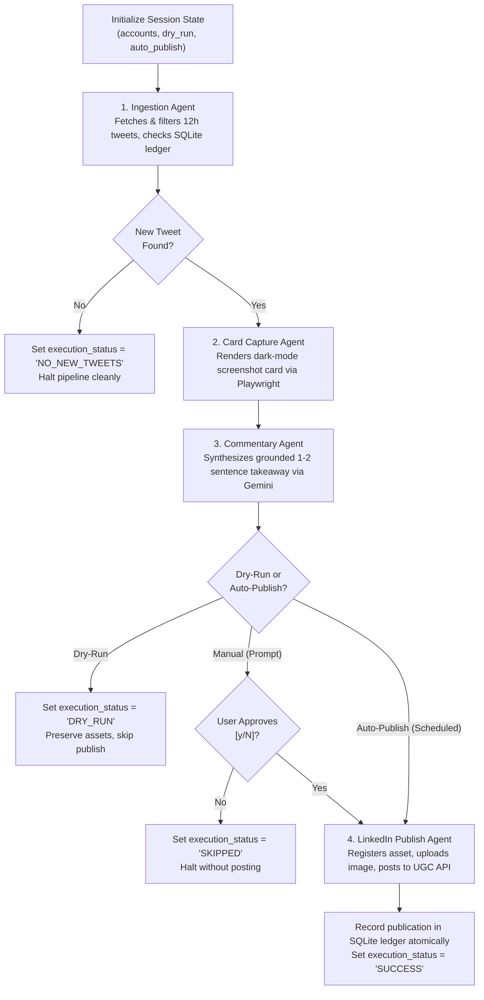

# Data Model & Schema: Google ADK Sequential & Scheduled Agent Pipeline

**Feature Branch**: `001-adk-agent-pipeline`  
**Date**: 2026-10-17  
**Status**: Complete  

## Overview
This document specifies the core domain models, ADK session state contracts, validation rules, and SQLite persistence schema for the Google ADK Tweet-to-LinkedIn pipeline.

---

## 1. Domain Entities (Pydantic v2 Models)

### `SourceTweet`
Represents an eligible tweet extracted from Twitter/X.

| Field | Type | Description | Constraints |
|---|---|---|---|
| `tweet_id` | `str` | Unique Twitter post identifier | Non-empty digit string |
| `author_handle` | `str` | Twitter handle without `@` symbol | 1–15 alphanumeric / underscore chars |
| `author_name` | `str` | Display name of the author | Non-empty string |
| `text` | `str` | Raw text content of the tweet | Non-empty string |
| `created_at` | `datetime` | UTC timestamp of tweet creation | Must be within last 12 hours |
| `permalink` | `str` | Full web URL to the tweet | Valid `https://x.com/...` URL |
| `media_urls` | `list[str]` | Optional URLs to images/videos attached | Default empty list |

### `ScreenshotConfig`
Configures visual capture behavior for Playwright.

| Field | Type | Description | Default |
|---|---|---|---|
| `theme` | `Literal["dark", "light"]` | Visual theme of the card | `"dark"` |
| `hide_metrics` | `bool` | Whether to suppress engagement counts | `True` |
| `viewport_width` | `int` | Browser viewport width in pixels | `1200` |
| `viewport_height` | `int` | Browser viewport height in pixels | `800` |
| `timeout_seconds` | `int` | Max time waiting for tweet element | `15` |
| `output_dir` | `Path` | Directory where screenshots are saved | `Path(".assets/screenshots")` |

### `RenderedAsset`
Represents the local screenshot image generated by Playwright.

| Field | Type | Description | Constraints |
|---|---|---|---|
| `file_path` | `Path` | Absolute path to the generated image file | Must exist on filesystem |
| `mime_type` | `str` | MIME type of the image | `"image/png"` |
| `file_size_bytes` | `int` | Size of the image binary in bytes | Max 10MB (LinkedIn limit) |
| `width` | `int` | Image width in pixels | Positive integer |
| `height` | `int` | Image height in pixels | Positive integer |

### `Commentary`
Represents the AI-generated opinionated LinkedIn post text.

| Field | Type | Description | Constraints |
|---|---|---|---|
| `text` | `str` | Generated post body | 10–600 characters (1–2 punchy sentences) |
| `character_count` | `int` | Length of the commentary text | Positive integer |
| `model_name` | `str` | Identifier of the Gemini model used | e.g. `"gemini-3.8-flash"` |
| `grounded` | `bool` | Whether Google Search grounding was used | Default `True` |
| `generated_at` | `datetime` | UTC timestamp of generation | Valid datetime |

### `PublicationRecord`
Represents the completed or skipped publication transaction.

| Field | Type | Description | Constraints |
|---|---|---|---|
| `tweet_id` | `str` | Source tweet identifier | Non-empty string |
| `author_handle` | `str` | Source author handle | Non-empty string |
| `linkedin_post_urn` | `Optional[str]` | URN of published LinkedIn post | Format `urn:li:share:<id>` or `urn:li:ugcPost:<id>` |
| `linkedin_asset_urn` | `Optional[str]` | URN of uploaded digital media asset | Format `urn:li:digitalmediaAsset:<id>` |
| `status` | `Literal["PUBLISHED", "SKIPPED", "DRY_RUN", "FAILED"]` | Final outcome status | Required enum |
| `commentary_text` | `str` | Commentary attached to the post | Non-empty string |
| `published_at` | `Optional[datetime]` | Timestamp when published | Set on publication |
| `error_message` | `Optional[str]` | Failure diagnostics if failed | Optional |

---

## 2. ADK Shared Session State Contract

The ADK `SequentialAgent` workflow coordinates sub-agents via a shared `session.state` dictionary. The schema below governs the state transitions across pipeline stages:

```python
class PipelineSessionState(TypedDict, total=False):
    # Stage 0: Input Configuration
    monitored_accounts: list[str]
    lookback_hours: int
    dry_run: bool
    auto_publish: bool

    # Stage 1: Ingestion & Filtering Output
    eligible_tweets: list[dict]  # Serialized SourceTweet objects
    selected_tweet: Optional[dict]  # Serialized SourceTweet chosen for processing

    # Stage 2: Visual Card Rendering Output
    rendered_asset: Optional[dict]  # Serialized RenderedAsset (file_path, dimensions)

    # Stage 3: Commentary Synthesis Output
    commentary: Optional[dict]  # Serialized Commentary (text, model, grounded)

    # Stage 4: Publication & Persistence Output
    publication_record: Optional[dict]  # Serialized PublicationRecord
    execution_status: (
        str  # "SUCCESS" | "NO_NEW_TWEETS" | "DRY_RUN" | "SKIPPED" | "FAILED"
    )
    error: Optional[str]  # Diagnostic message if any stage fails
```

### State Transitions Across Sequential Agents



---

## 3. Database Schema (SQLite: `state/sidekick.db`)

The persistent publication ledger guarantees idempotency and tracks post audit history.

```sql
-- Publication Ledger Table
CREATE TABLE IF NOT EXISTS publication_ledger (
    id INTEGER PRIMARY KEY AUTOINCREMENT,
    tweet_id TEXT UNIQUE NOT NULL,
    author_handle TEXT NOT NULL,
    tweet_created_at TEXT NOT NULL,
    tweet_text TEXT NOT NULL,
    tweet_url TEXT NOT NULL,
    linkedin_post_urn TEXT,
    linkedin_asset_urn TEXT,
    commentary_text TEXT NOT NULL,
    status TEXT NOT NULL CHECK (status IN ('PENDING', 'PUBLISHED', 'SKIPPED', 'DRY_RUN', 'FAILED')),
    error_message TEXT,
    created_at TEXT NOT NULL DEFAULT (datetime('now', 'utc')),
    published_at TEXT
);

-- Indices for rapid lookup and duplicate checking
CREATE UNIQUE INDEX IF NOT EXISTS idx_ledger_tweet_id ON publication_ledger(tweet_id);
CREATE INDEX IF NOT EXISTS idx_ledger_status ON publication_ledger(status);
CREATE INDEX IF NOT EXISTS idx_ledger_author ON publication_ledger(author_handle);
```
