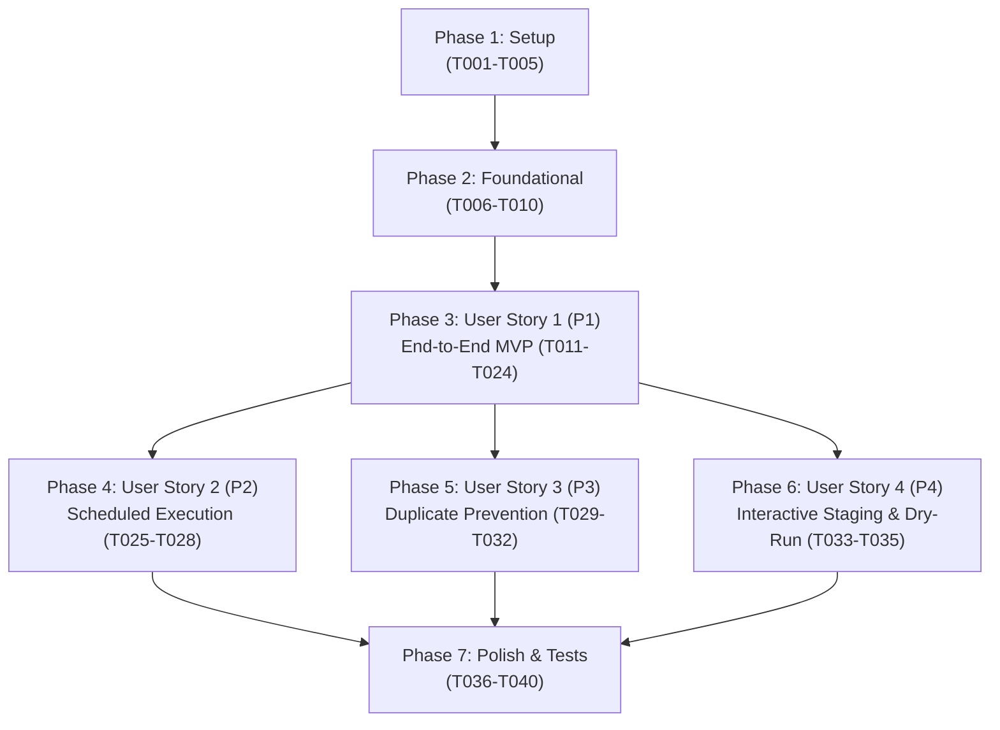

# Tasks: Google ADK Sequential & Scheduled Agent Pipeline

**Input**: Design artifacts from `specs/001-adk-agent-pipeline/` (`spec.md`, `plan.md`, `data-model.md`, `contracts/`, `research.md`, `quickstart.md`)  
**Status**: Ready for Implementation  

---

## Phase 1: Setup (Shared Infrastructure)

**Purpose**: Project initialization, dependency specification, and shared configuration files

- [X] T001 Initialize Python environment dependencies in `requirements.txt` with `google-adk`, `google-genai`, `twikit`, `playwright`, `httpx`, `pydantic`, `pyyaml`, `python-dotenv`, and `rich`
- [X] T002 [P] Configure project packaging and development toolchains in `pyproject.toml` with Ruff, mypy, and Pytest settings
- [X] T003 [P] Create application package directory structure per plan in `src/agent/`, `src/twitter/`, `src/render/`, `src/linkedin/`, `src/storage/`, `tests/unit/`, and `tests/integration/` with `__init__.py` files
- [X] T004 [P] Create environment template in `.env.example` specifying `GOOGLE_API_KEY`, `LINKEDIN_ACCESS_TOKEN`, `LINKEDIN_PERSON_URN`, and `CONFIG_PATH`. Deviation (2026-10-18): the `TWITTER_COOKIES_PATH` and `SIDEKICK_DB_PATH` overrides were dropped so that `twitter.cookies_path` and `storage.db_path` are configured only in `config.yaml`, eliminating a second source of truth for each path.
- [X] T005 [P] Create default application configuration in `config.yaml` specifying monitored accounts (`sama`, `karpathy`, `ylecun`), 12h lookback window, dark theme, metric suppression, and Gemini agent parameters

---

## Phase 2: Foundational (Blocking Prerequisites)

**Purpose**: Core configuration, logging, database persistence, and ADK session state types required by all user stories

**⚠️ CRITICAL**: No user story work can begin until this phase is complete.

- [X] T006 Implement configuration loader and schema validation models in `src/config.py` loading `.env` secrets and `config.yaml` settings
- [X] T007 [P] Implement structured logging system in `src/logging.py` providing formatted console output and file diagnostics
- [X] T008 [P] Implement SQLite database connection manager and schema initialization in `src/storage/db.py` creating table `publication_ledger` with unique index on `tweet_id`
- [X] T009 Implement publication ledger repository operations in `src/storage/ledger.py` for recording runs, querying unposted tweets, marking publications, and enforcing idempotency
- [X] T010 [P] Implement ADK session state types and models in `src/agent/state.py` defining `PipelineSessionState` with typed keys for `monitored_accounts`, `selected_tweet`, `rendered_asset`, `commentary`, and `publication_record`

**Checkpoint**: Foundation ready — user story implementation can now begin.

---

## Phase 3: User Story 1 - End-to-End Discovery, Card Capture, AI Synthesis & LinkedIn Publication (Priority: P1) 🎯 MVP

**Goal**: Complete end-to-end autonomous agent workflow discovering an eligible tweet, capturing a dark-mode screenshot card, synthesizing grounded commentary via Gemini, and publishing to LinkedIn via Google ADK `SequentialAgent`.

**Independent Test**: Configure a monitored account with an authored tweet in the last 12 hours, run the sequential pipeline, and verify the post appears on LinkedIn with the attached card screenshot and commentary text.

### Implementation for User Story 1

- [X] T011 [P] [US1] Implement Twitter cookie authentication loader and validation in `src/twitter/auth.py` loading session cookies from `cookies.json`
- [X] T012 [P] [US1] Implement `SourceTweet` Pydantic entity model in `src/twitter/models.py` with fields `tweet_id` (non-empty digit string), `author_handle` (1-15 chars), `author_name`, `text`, `created_at` (UTC within last 12 hours), `permalink`, and `media_urls`
- [X] T013 [US1] Implement Twitter timeline fetcher in `src/twitter/fetcher.py` using `twikit` to fetch author tweets while excluding replies and retweets
- [X] T014 [US1] Implement `TweetIngestionAgent` discovery step in `src/agent/ingestion.py` that fetches recent tweets via `src/twitter/fetcher.py` and stores `selected_tweet` in `session.state`
- [X] T015 [P] [US1] Implement Playwright card styling and DOM injection scripts in `src/render/styles.py` suppressing metric groups (`[role="group"]`) and forcing dark theme
- [X] T016 [P] [US1] Implement `ScreenshotConfig` and `RenderedAsset` models in `src/render/screenshot.py` enforcing PNG mime type and maximum file size of 10MB
- [X] T017 [US1] Implement Playwright browser card capture engine in `src/render/screenshot.py` launching headless Chromium, isolating `article[data-testid="tweet"]`, and saving PNG to `.assets/screenshots/`
- [X] T018 [US1] Implement `CardCaptureAgent` step in `src/agent/capture.py` taking `selected_tweet` from `session.state`, capturing card screenshot, and recording `rendered_asset` in `session.state`
- [X] T019 [P] [US1] Implement `Commentary` entity model in `src/agent/commentary.py` enforcing 10–600 character constraint (1–2 concise punchy sentences) and tracking model and grounding flags
- [X] T020 [US1] Implement `CommentaryAgent` in `src/agent/commentary.py` using Google ADK `Agent`/`LlmAgent` and Gemini (`gemini-3.8-flash`) with Google Search grounding enabled by default to store synthesized commentary in `session.state["commentary"]`
- [X] T021 [P] [US1] Implement LinkedIn API request and response models in `src/linkedin/models.py` for `registerUpload`, binary asset PUT, and `ugcPosts` payload
- [X] T022 [US1] Implement LinkedIn REST v2 client in `src/linkedin/client.py` and `src/linkedin/assets.py` handling OAuth headers, media asset registration, binary upload, and UGC post creation
- [X] T023 [US1] Implement `LinkedInPublisherAgent` in `src/agent/publisher.py` consuming `rendered_asset` and `commentary` from `session.state`, publishing to LinkedIn, and committing transaction to `src/storage/ledger.py`
- [X] T024 [US1] Implement root `SequentialAgent` pipeline workflow in `src/agent/pipeline.py` assembling `TweetIngestionAgent` → `CardCaptureAgent` → `CommentaryAgent` → `LinkedInPublisherAgent` over `InMemorySessionService`

**Checkpoint**: At this point, User Story 1 delivers a complete, independently testable end-to-end MVP.

---

## Phase 4: User Story 2 - Scheduled & Autonomous Periodic Execution (Priority: P2)

**Goal**: Enable hands-free autonomous execution via a dual-mode runner supporting both on-demand single execution (for external schedulers) and continuous in-process interval scheduling.

**Independent Test**: Start the runner with `--interval 60` or `--single-run`, verify the agent awakens, executes the sequential pipeline in unattended mode (`auto_publish=True`), and sleeps cleanly between intervals.

### Implementation for User Story 2

- [X] T025 [P] [US2] Implement dual-mode runner argument parsing in `src/runner.py` supporting `--single-run`, `--interval <minutes>`, `--auto-publish`, `--dry-run`, and `--accounts`
- [X] T026 [US2] Implement single-run on-demand execution path in `src/runner.py` invoking the `SequentialAgent` pipeline for external cron or Task Scheduler triggers
- [X] T027 [US2] Implement continuous periodic scheduling loop in `src/runner.py` invoking the sequential pipeline at configured minute intervals in unattended mode with graceful `SIGINT` handling
- [X] T028 [US2] Implement empty-window handling in `src/agent/ingestion.py` and `src/runner.py` logging informative no-op results (`execution_status = "NO_NEW_TWEETS"`) when candidate timelines have no new tweets

**Checkpoint**: User Stories 1 and 2 operate together, enabling unattended autonomous scheduled execution.

---

## Phase 5: User Story 3 - Time-Window Filtering & Idempotency Duplicate Prevention (Priority: P3)

**Goal**: Guarantee that only posts created within 12 hours are ingested and that previously published tweets are atomically skipped to prevent duplicates.

**Independent Test**: Publish a tweet, run the pipeline a second time immediately, and verify that the tweet is skipped with a logged notice.

### Implementation for User Story 3

- [X] T029 [P] [US3] Implement strict 12-hour timestamp cutoff filtering in `src/twitter/fetcher.py` comparing tweet UTC creation timestamps against `datetime.now(timezone.utc) - timedelta(hours=12)`
- [X] T030 [US3] Implement deduplication query in `src/storage/ledger.py` checking `publication_ledger` for existing published tweet IDs
- [X] T031 [US3] Integrate ledger deduplication filtering into `TweetIngestionAgent` in `src/agent/ingestion.py` to filter candidate tweets against the publication ledger before choosing `selected_tweet`
- [X] T032 [US3] Implement atomic uniqueness error handling in `src/storage/ledger.py` catching SQLite `IntegrityError` to safeguard against duplicate race conditions

**Checkpoint**: Pipeline strictly enforces the 12-hour window and guarantees atomic deduplication.

---

## Phase 6: User Story 4 - Interactive Staging, Preview & Editorial Review (Priority: P4)

**Goal**: Provide rich terminal preview, interactive `[y/N]` confirmation prompts for manual runs, and safe dry-run inspection without external publishing.

**Independent Test**: Run `python -m src.runner --single-run --dry-run` and verify that screenshot and commentary are generated and displayed with zero calls to LinkedIn API.

### Implementation for User Story 4

- [X] T033 [P] [US4] Implement terminal preview presentation in `src/runner.py` using `rich` displaying tweet details, local screenshot card path, and synthesized commentary
- [X] T034 [US4] Implement interactive confirmation prompt (`Publish to LinkedIn? [y/N]`) in `src/runner.py` during manual on-demand execution, setting `execution_status = "SKIPPED"` if declined
- [X] T035 [US4] Implement dry-run evaluation logic in `src/agent/publisher.py` and `src/runner.py` that skips LinkedIn network requests when `dry_run=True`, preserving rendered images and setting `execution_status = "DRY_RUN"`

**Checkpoint**: All user stories functional and editorial review/staging capabilities verified.

---

## Phase 7: Polish & Cross-Cutting Concerns

**Purpose**: Test suites, linting, type validation, documentation, and quickstart verification

- [X] T036 [P] Implement unit tests for Twitter ingestion, Playwright card capture, commentary generation, LinkedIn client, and SQLite ledger in `tests/unit/test_twitter.py`, `tests/unit/test_render.py`, `tests/unit/test_commentary.py`, `tests/unit/test_linkedin.py`, and `tests/unit/test_storage.py`
- [X] T037 [P] Implement end-to-end integration test for ADK `SequentialAgent` workflow in `tests/integration/test_sequential_agent.py`
- [X] T038 Execute code formatting and type checking with `ruff check .`, `ruff format .`, and `mypy src`
- [X] T039 Execute end-to-end validation against `specs/001-adk-agent-pipeline/quickstart.md` validating dry-run, interactive confirmation, and scheduled execution. Note (2026-10-18): executed with faked network boundaries only; the defects that a live run surfaced are recorded in Phase 8.
- [X] T040 [P] Update project `README.md` with Google ADK sequential agent architecture, configuration instructions, and runner usage guides

**Checkpoint**: Phase 7 was validated against the quickstart with faked network boundaries. The first *live* run exposed four integration defects that no fake could catch; they are fixed in Phase 8.

---

## Phase 8: Live Dry-Run Remediation (post-implementation)

**Purpose**: Make a real run against X, Chromium, and Gemini succeed. Every task below was found by executing `python -m src.runner --single-run --dry-run` against live services.

- [X] T041 Pin `twikit==2.1.2` in `requirements.txt` and `pyproject.toml`. Deviation (2026-10-18): `twikit>=2.3` bootstraps an `x-client-transaction-id` token by scraping X's `ondemand.s` webpack chunk, and X removed that reference, so every request raised `Couldn't get KEY_BYTE indices` (upstream `d60/twikit#408`). `2.1.2` predates the bootstrap and matches the version already recorded in `research.md` (`^2.1.2`).
- [X] T042 Add `src/twitter/compat.py` with two idempotent shims: backfill the `twikit.user.User` fields X no longer sends (`entities.description.urls`, `pinned_tweet_ids_str`, `withheld_in_countries`), and restore the Windows **proactor** event-loop policy that importing `twikit` overwrites (Playwright cannot spawn Chromium on a selector loop). Wire the model patch into `src/twitter/auth.py::_import_client` and the policy restore into `src/runner.py::main` before the loop is created.
- [X] T043 Replay the authenticated Twitter session into the capture browser. `TweetCardRenderer` now accepts `cookies` and installs them for `.x.com` in `start()`; `CardCaptureAgent` loads them from `config.twitter.cookies_path`. X gates tweet permalinks behind a login wall, so an anonymous context found no card.
- [X] T044 Fix card styling so the visibility wait can succeed: drop `[data-testid="primaryColumn"] > div:first-child` from `CHROME_SELECTORS` (X nests the tweet inside that node, so hiding it hid the card) and inject styling *after* the card is visible.
- [X] T045 [P] Add regression tests: `tests/unit/test_compat.py`, capture-authentication and style-ordering cases in `tests/unit/test_render.py`, and the capture-agent cookie path in `tests/unit/test_config.py`.
- [ ] T046 Implement the constitution's HTTP 429 grounding fallback in `src/agent/commentary.py` so grounded synthesis degrades to direct synthesis instead of aborting the run. Still unimplemented; an exhausted Gemini quota currently fails the whole pipeline.

---

## Dependencies & Execution Order

### Phase Dependencies



### Within Each User Story
- Models & configurations before agents/services
- Sub-agents before root `SequentialAgent` assembly
- Core implementation before UI/CLI runner integration

### Parallel Opportunities

- **Phase 1 Setup**: `T002`, `T003`, `T004`, `T005` can run in parallel.
- **Phase 2 Foundational**: `T007`, `T008`, `T010` can run in parallel once `T006` is initialized.
- **Phase 3 User Story 1**: 
  - `T011` (Auth), `T012` (Tweet Model), `T015` (Styles), `T016` (Render Models), `T019` (Commentary Model), `T021` (LinkedIn Models) can all be built in parallel.
- **Phase 7 Polish**: Unit test suites `T036`, integration tests `T037`, and documentation `T040` can run in parallel.

---

## Parallel Example: User Story 1 Components

```bash
# Launch independent models and utility modules in parallel:
Task: "Implement SourceTweet entity model in src/twitter/models.py" (T012)
Task: "Implement Playwright card styling in src/render/styles.py" (T015)
Task: "Implement Commentary entity model in src/agent/commentary.py" (T019)
Task: "Implement LinkedIn API request/response models in src/linkedin/models.py" (T021)
```

---

## Implementation Strategy

### MVP First (User Story 1 Only)
1. Complete **Phase 1: Setup** (`T001`–`T005`).
2. Complete **Phase 2: Foundational** (`T006`–`T010`).
3. Complete **Phase 3: User Story 1** (`T011`–`T024`).
4. **Validate MVP**: Test single-tweet discovery, card capture, commentary generation, and LinkedIn publishing.

### Incremental Delivery
1. **MVP Deployed**: Single-run pipeline operational.
2. **Add User Story 2**: Introduce continuous periodic scheduler loop (`T025`–`T028`).
3. **Add User Story 3**: Enforce 12h time-window and SQLite idempotency checks (`T029`–`T032`).
4. **Add User Story 4**: Add rich terminal preview, interactive confirmation, and dry-run flag (`T033`–`T035`).
5. **Phase 7 Polish**: Run full unit tests, integration tests, type checks, and update documentation (`T036`–`T040`).
