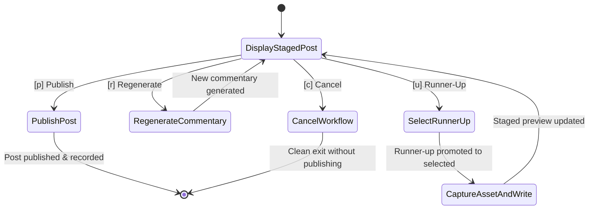

# Contract: Interactive Editorial Review Specification (Google ADK Architecture)

**Feature Branch**: `002-curator-and-persona-commentary`  
**Date**: 2026-10-18  
**Spec**: [spec.md](../spec.md)

---

## 1. Review Terminal Display

During manual execution via `runner.py` (when `--auto-publish` is false), the `LinkedInPublisherAgent` displays the staged post state using `rich` formatting:

```text
================================================================================
                    LINKEDIN SIDEKICK (ADK) - EDITORIAL REVIEW
================================================================================

[CANDIDATE POOL]
  Total unposted tweets evaluated: 8 across 3 monitored accounts.

[CURATOR SELECTION]
  Author:     @karpathy
  Tweet ID:   184657123456789
  Created:    2026-10-17 18:24 UTC
  Tweet Text: "The hardest part of building reliable AI agents in production isn't
               the model itself, it's the deterministic error ladder and recovery..."
  Permalink:  https://x.com/karpathy/status/184657123456789

[CURATOR RATIONALE]
  Directly addresses production automation failure modes and recovery ladders,
  which perfectly matches our audience of technical leads and our core topic
  rubric. Outranks competing candidates due to actionable engineering substance.

[RUNNER-UP CANDIDATES]
  1. @sama (ID: 184656987654321) - Compute scaling infrastructure
  2. @ylecun (ID: 184655432109876) - Open weights vs proprietary models

[VISUAL ASSET]
  Screenshot: .assets/screenshots/tweet_184657123456789.png

[GENERATED COMMENTARY]
  Reliability isn't a prompt engineering problem.

  In production, our incident response dropped from 60 minutes to 5 only when we
  built an automated ladder: restart the service, then the app pool, then the
  cluster, and only then wake up a human.

  If an agent can't fail deterministically, it shouldn't run in production.

--------------------------------------------------------------------------------
[ACTIONS]
  [p] Publish to LinkedIn immediately
  [r] Regenerate commentary for current tweet
  [u] Select next runner-up tweet (@sama)
  [c] Cancel and exit without publishing
--------------------------------------------------------------------------------
Select action [p/r/u/c]: 
```

---

## 2. Review Action State Machine



---

## 3. ADK Runner Flags Contract

| Flag | Type | Default | Description |
|---|---|---|---|
| `--auto-publish` | boolean | `False` | Bypasses interactive review menu and publishes immediately upon successful curation and generation. |
| `--dry-run` | boolean | `False` | Executes full curation, screenshot capture, and commentary generation, logs all decisions, but skips LinkedIn API publishing. |
| `--accounts` | comma-separated list | None (uses config) | Dynamically overrides target Twitter handles to monitor for this run. |
| `--context-dir` | path | `context` | Custom path to context markdown directory. |
