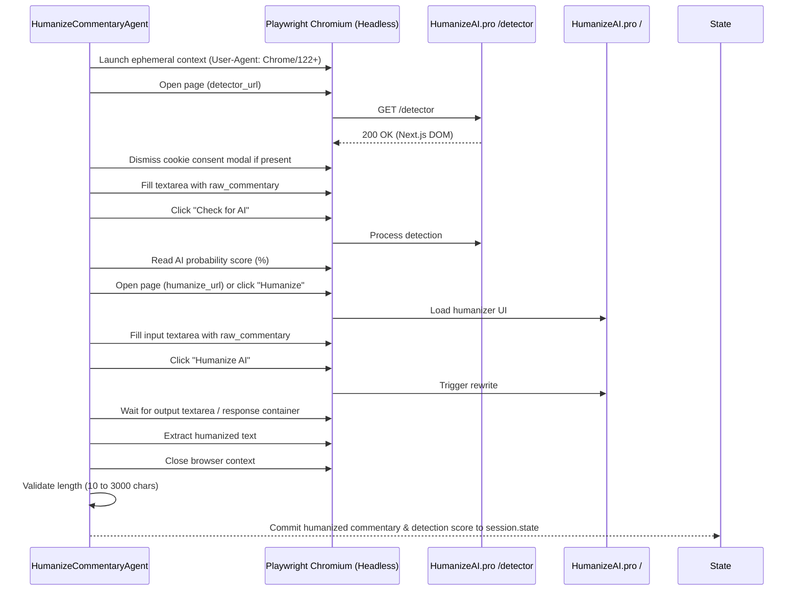

# Contract: HumanizeCommentaryAgent Interface & Execution Flow

**Component**: `src.agent.humanize.HumanizeCommentaryAgent`  
**Base Class**: `google.adk.agents.BaseAgent`  
**Pipeline Location**: Inserted sequentially between `commentary_agent` (`LlmAgent`) and `LinkedInPublisherAgent` (`BaseAgent`).

---

## 1. Session State Inputs & Preconditions

| State Key | Type | Description | Mandatory |
|---|---|---|:---:|
| `KEY_COMMENTARY` / `KEY_COMMENTARY_RAW` | `dict` or `str` | Raw style-guided commentary synthesized by `commentary_agent`. | **Yes** |
| `KEY_EXECUTION_STATUS` | `str` | Upstream stage status (must not be `FAILED` or short-circuited). | **Yes** |
| `KEY_SELECTED_TWEET` / `KEY_SELECTED_ITEM` | `dict` | Selected candidate content item. | **Yes** |

### Precondition Checks:
- If `KEY_EXECUTION_STATUS == STATUS_FAILED` or upstream stage short-circuited (e.g. `NO_QUALIFIED_CANDIDATE`), the agent is a clean no-op and returns `None`.
- If `config.humanize.enabled is False`, the agent marks `KEY_HUMANIZE_STATUS = "BYPASSED"` and passes through the raw commentary directly.

---

## 2. Session State Outputs & Side Effects

| State Key | Type | Description |
|---|---|---|
| `KEY_COMMENTARY_RAW` | `str` | Preserved verbatim copy of original LLM commentary. |
| `KEY_HUMANIZED_COMMENTARY` | `str` | Rewritten text from HumanizeAI, or raw commentary if bypassed. |
| `KEY_AI_DETECTION_SCORE` | `float` or `None` | Percentage AI probability score (0.0 to 100.0). |
| `KEY_HUMANIZE_STATUS` | `str` | One of `SUCCESS`, `FAILED`, `BYPASSED`. |
| `KEY_COMMENTARY` | `dict` | Serialized `Commentary` entity whose `text` reflects the humanized content. |
| `KEY_EXECUTION_STATUS` | `str` | Updated to `STATUS_FAILED_HUMANIZATION` if humanization fails after retries. |

---

## 3. DOM Automation Sequence & Protocol

---

## 4. Error Handling & Retry Specification

1. **Transient Timeout Handling**:
   - If `page.goto()` or element query exceeds `timeout_seconds` (default: 30s), catch `playwright.async_api.TimeoutError`.
   - If `auto_retry` is `True` and attempt is 0:
     - Log: `"HumanizeAI automation timed out. Waiting 2.0s before automatic retry 1/1."`
     - Sleep `retry_cooldown_seconds` (default: 2.0s).
     - Launch a fresh browser context and retry the full sequence.
2. **Exhausted Retries / Unrecoverable Error**:
   - If retry fails, catch exception, close browser context cleanly.
   - Record `session.state[KEY_HUMANIZE_STATUS] = "FAILED"`.
   - Record `session.state[KEY_ERROR] = "HumanizeAI automation failed: <error detail>"`.
   - Update `session.state[KEY_EXECUTION_STATUS] = "FAILED_HUMANIZATION"`.
