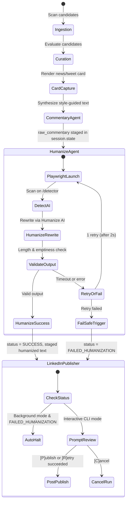

# Data Model & State Schema: Style-Driven Commentary Synthesis and HumanizeAI Pipeline

**Branch**: `004-humanize-commentary-pipeline` | **Date**: 2026-10-20 | **Spec**: [spec.md](spec.md)

This document specifies the domain models, session state contract, and configuration schemas for the commentary synthesis and Playwright HumanizeAI pipeline integration.

---

## 1. Domain Entities & Schemas

### A. `HumanizeConfig`
Configuration parameters parsed from `config.yaml` governing the Playwright browser automation lifecycle and failure tolerance.

```python
class HumanizeConfig(BaseModel):
    """Configuration for Playwright HumanizeAI automation."""

    enabled: bool = Field(
        default=True,
        description="Whether to execute the HumanizeAI step before publication.",
    )
    headless: bool = Field(
        default=True,
        description="Run Chromium in headless mode (set False for debugging DOM flows).",
    )
    timeout_seconds: float = Field(
        default=30.0,
        ge=5.0,
        le=120.0,
        description="Maximum seconds to wait for page navigation and completion.",
    )
    detector_url: str = Field(
        default="https://www.humanizeai.pro/detector",
        description="URL for AI detection scanning.",
    )
    humanize_url: str = Field(
        default="https://www.humanizeai.pro/",
        description="URL for text humanization rewriting.",
    )
    auto_retry: bool = Field(
        default=True,
        description="Whether to perform 1 automatic retry on transient page/selector timeouts.",
    )
    retry_cooldown_seconds: float = Field(
        default=2.0,
        ge=0.5,
        le=10.0,
        description="Cooldown duration before executing the automatic retry.",
    )
```

### B. `AIDetectionResult`
Represents the outcome of analyzing a draft commentary against the HumanizeAI detection tool.

```python
class AIDetectionResult(BaseModel):
    """Result of scanning commentary through HumanizeAI detector."""

    ai_probability: float = Field(
        ge=0.0,
        le=100.0,
        description="Detected probability of AI generation as a percentage (0.0 to 100.0).",
    )
    classification: str = Field(
        default="AI",
        description="Qualitative label (e.g. 'Human', 'Mixed', 'AI-generated').",
    )
    scanned_at: datetime = Field(
        default_factory=lambda: datetime.now(UTC),
        description="Timestamp when the detection scan was performed.",
    )
```

### C. `HumanizedCommentary`
Encapsulates the end-to-end transformation of commentary, including the original draft, humanized copy, detection score, and operational status.

```python
class HumanizeStatus(StrEnum):
    SUCCESS = "SUCCESS"
    FAILED = "FAILED"
    BYPASSED = "BYPASSED"


class HumanizedCommentary(BaseModel):
    """Result of the HumanizeAI Playwright transformation."""

    raw_text: str = Field(
        description="The original style-guided commentary text generated by the LLM.",
    )
    humanized_text: str = Field(
        description="The rewritten text obtained from HumanizeAI, or fallback text if bypassed.",
    )
    detection_score: float | None = Field(
        default=None,
        description="The AI probability percentage returned by the detector.",
    )
    status: HumanizeStatus = Field(
        default=HumanizeStatus.SUCCESS,
        description="Status of the humanization stage.",
    )
    error_message: str | None = Field(
        default=None,
        description="Diagnostic error details if the stage failed or triggered the fail-safe.",
    )
    transformed_at: datetime = Field(
        default_factory=lambda: datetime.now(UTC),
        description="Timestamp of the transformation.",
    )
```

### D. `Commentary` (Updated Entity in `src/agent/commentary.py`)
Augmented to track humanization provenance and relaxed structural bounds:

```python
class Commentary(BaseModel):
    """AI-generated and humanized opinionated LinkedIn post text."""

    model_config = ConfigDict(extra="ignore")

    text: str = Field(
        min_length=10,
        max_length=3000,  # Relaxed to platform bounds (LinkedIn post limit)
    )
    paragraph_count: int = 1
    character_count: int = 0
    model_name: str = "unknown"
    grounded: bool = True
    humanized: bool = False
    ai_detection_score: float | None = None
    generated_at: datetime = Field(default_factory=lambda: datetime.now(UTC))
```

---

## 2. ADK Session State Contract

The pipeline stages interact strictly through typed keys in `session.state`.

### New Session State Keys (`src/agent/state.py`):
```python
KEY_COMMENTARY_RAW: str = "raw_commentary"
KEY_AI_DETECTION_SCORE: str = "ai_detection_score"
KEY_HUMANIZE_STATUS: str = "humanize_status"
KEY_HUMANIZED_COMMENTARY: str = "humanized_commentary"

STATUS_FAILED_HUMANIZATION: str = "FAILED_HUMANIZATION"
```

### State Flow Diagram:

