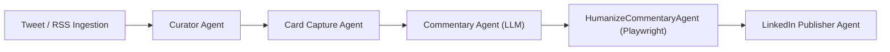

# Research & Technical Decisions: Style-Driven Commentary Synthesis and HumanizeAI Pipeline

**Branch**: `004-humanize-commentary-pipeline` | **Date**: 2026-10-20 | **Spec**: [spec.md](spec.md)

This document records the architectural investigations, trade-off evaluations, and concrete technical decisions for eliminating hardcoded writing guardrails and integrating headless Playwright HumanizeAI automation.

---

## 1. Decommissioning Hardcoded Writing Guardrails & Corrective Loops

### Context & Problem
The current codebase enforces style constraints through multiple brittle, programmatic layers:
- `src/agent/guardrails.py`: A static list of 50+ banned words (`BANNED_WORDS`), regexes for emojis, hashtags, em dashes, and paragraph-count bounds.
- `src/agent/commentary.py`: A corrective re-prompting callback (`_build_after_model_callback`) that intercepts the LLM completion and issues up to two recursive re-prompts to Gemini if any banned word or paragraph rule is violated.
- `context/writer/style_guide.md`: A rigid, cookie-cutter post architecture requiring "Exactly 3 short paragraphs (exactly 7 sentences, 60 to 85 words total)" with sentence-by-sentence word brackets ("Sentence 1: 8–14 words, Sentence 2: 4–6 words...").

This architecture causes significant problems:
1. False-positive rejections on legitimate engineering terminology (e.g., "infrastructure", "bottleneck", "fundamental").
2. Fragile multi-turn LLM re-prompt loops that add latency and occasionally fail entirely.
3. Monotonous, repetitive post structures ("the damm same format") that sound unnatural and robotic.

### Decision
1. **Retire Programmatic Guardrail Rejection**: Remove `BANNED_WORDS` regex scanning, rigid formatting validation, and the corrective re-prompt loop from `src/agent/commentary.py`.
2. **Context-Driven Steering**: Shift style and voice adherence entirely to prompt construction using the writing context files (`context/writer/system_context.md`, `context/writer/style_guide.md`, and `context/writer/ai_writing_signals.md`).
3. **Flexible 1–3 Paragraph Architecture**: Update `style_guide.md` to define a loose rhetorical framework (sharp hook, analytical trade-off/breakdown, grounded takeaway across 1–3 paragraphs) without rigid sentence counts or word-length quotas.
4. **Platform Sanity Bounds**: Maintain only essential platform safety bounds (non-empty post, maximum LinkedIn character limit of ~3,000 characters, prevention of broken tags) as basic sanity checks.

### Alternatives Considered
- *Retain a reduced banned-word list*: Rejected. Any programmatic word-ban list remains brittle and prone to false positives across varied technical subjects.
- *Strict regex format checking without re-prompting*: Rejected. Dropping paragraphs programmatically breaks logical coherence; the generative prompt is better suited for natural structuring.

---

## 2. Playwright Web Automation for HumanizeAI.pro

### Context & Investigation
The user requested integrating `https://www.humanizeai.pro/detector` to detect AI likelihood and humanize the generated commentary prior to publication. During clarification, the user chose **Playwright Web Automation Only** (eliminating the need for paid developer API keys or subscriptions).

DOM and network analysis of `https://www.humanizeai.pro/detector` revealed:
- The site runs on Next.js with Cloudflare protection. When requested with standard browser user-agents via Playwright, the application loads successfully without triggering captchas.
- The detector interface (`/detector`) provides text input, a "Check for AI" action, and score gauges.
- The humanizer interface (`https://www.humanizeai.pro/`) provides dual textareas (input and rewritten output) with a "Humanize AI" action.
- Ephemeral headless Chromium contexts (matching the Playwright configuration in `src/render/news_card.py` and `src/render/screenshot.py`) provide complete process isolation without leaving zombie browser sessions.

### Decision
Implement a dedicated Playwright automation module (`src/agent/humanize.py`) with:
1. **Ephemeral Browser Management**: Launch headless Chromium per execution cycle with standard user-agent and viewport settings.
2. **Two-Stage Workflow**:
   - Navigate to `https://www.humanizeai.pro/detector` to run AI detection, extracting the initial AI probability score.
   - Execute the humanization workflow (via `Humanize AI` action) to obtain the rewritten humanized text.
3. **Resilient DOM Interaction**:
   - Use direct element filling (`page.fill("textarea", ...)` or `page.evaluate(...)`) rather than raw coordinate clicks to avoid pointer event interception from floating UI action bars (e.g. `TextareaBlock_actions` overlay).
   - Dispatch `input` and `change` events to ensure Next.js React component state reflects the updated text.
   - Wait for network idle or selector updates (`wait_for_selector`) after triggering "Check for AI" and "Humanize" actions.
4. **Configurable Settings**: Support headless toggle (`headless: true`), timeout thresholds, and retry settings in `config.yaml`.

---

## 3. Sequential Agent Placement & Session State Schema

### Context & Pipeline Architecture
The project uses Google's Agent Development Kit (ADK) `SequentialAgent` pipeline (`linkedin_sidekick_pipeline`).
Sub-agents communicate exclusively via typed keys in `session.state`.

### Decision
Insert `HumanizeCommentaryAgent` as an independent `BaseAgent` between `commentary_agent` and `LinkedInPublisherAgent`:

#### Typed State Keys:
- `KEY_COMMENTARY_RAW` (`"raw_commentary"`): The original style-guided commentary text generated by Gemini.
- `KEY_AI_DETECTION_SCORE` (`"ai_detection_score"`): The AI probability percentage (0–100%) detected by HumanizeAI.
- `KEY_HUMANIZE_STATUS` (`"humanize_status"`): Execution status of the humanization stage (`"SUCCESS"`, `"FAILED"`, `"BYPASSED"`).
- `KEY_COMMENTARY` (`"commentary"`): The final `Commentary` entity. When humanization succeeds, `commentary.text` is the humanized version; when fail-safe bypasses with approval, it contains the raw commentary.

---

## 4. Failure Modes, Transient Retry & Strict Fail-Safe Policy

### Context & Operational Safety
External web scraping is inherently subject to external variances (latency, DOM changes, Cloudflare rate-limits, anti-bot challenges). The user explicitly specified a **Strict Fail-Safe** policy to protect their LinkedIn profile reputation.

### Decision
1. **Single Automatic Retry**: If a page navigation or DOM query times out, wait 2 seconds and retry the operation once.
2. **Strict Fail-Safe Escalation**: If the retry also fails:
   - Automated / Scheduled Background Run: Halt publishing immediately, record status `FAILED_HUMANIZATION` or `SKIPPED`, and persist the draft in the database for later manual review.
   - Interactive CLI Run: Present a 4-option manual recovery menu:
     - `[P]ublish unhumanized commentary`: Proceed with the original style-guided LLM text.
     - `[R]etry HumanizeAI`: Re-trigger the Playwright automation session.
     - `[G]enerate new commentary`: Re-invoke commentary synthesis from scratch.
     - `[C]ancel`: Abort the publication cleanly.
