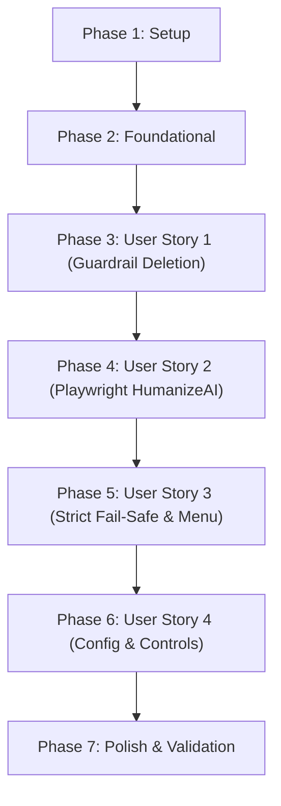

# Tasks: Style-Driven Commentary Synthesis and HumanizeAI Pipeline Integration

**Input**: Design documents from `/specs/004-humanize-commentary-pipeline/` (`spec.md`, `plan.md`, `research.md`, `data-model.md`, `contracts/`, `quickstart.md`)  
**Prerequisites**: plan.md (required), spec.md (required for user stories), research.md, data-model.md, contracts/  
**Organization**: Tasks are grouped by user story to enable independent implementation and testing of each story increment.

---

## Format: `[ID] [P?] [Story] Description with file path`

- **[P]**: Can run in parallel (different files, no blocking dependencies)
- **[Story]**: Which user story this task belongs to (`[US1]`, `[US2]`, `[US3]`, `[US4]`)
- Every task includes exact file paths

---

## Phase 1: Setup (Shared Infrastructure)

**Purpose**: Project initialization, dependency verification, and configuration schema setup

- [X] T001 Verify Playwright Chromium browser binaries and dependencies are installed via `playwright install chromium`
- [X] T002 [P] Define `HumanizeConfig` Pydantic model (`enabled: bool = True`, `headless: bool = True`, `timeout_seconds: float = 30.0` with `ge=5.0, le=120.0`, `detector_url: str = "https://www.humanizeai.pro/detector"`, `humanize_url: str = "https://www.humanizeai.pro/"`, `auto_retry: bool = True`, `retry_cooldown_seconds: float = 2.0` with `ge=0.5, le=10.0`) in `src/config.py`
- [X] T003 [P] Add default `humanize:` configuration block and comments in `config.yaml` matching `contracts/humanize-config-contract.md`

---

## Phase 2: Foundational (Blocking Prerequisites)

**Purpose**: Core state keys and shared domain models that MUST be complete before user stories execute

**⚠️ CRITICAL**: No user story implementation work can begin until this phase is complete.

- [X] T004 Add session state keys and execution statuses in `src/agent/state.py` (`KEY_COMMENTARY_RAW = "raw_commentary"`, `KEY_AI_DETECTION_SCORE = "ai_detection_score"`, `KEY_HUMANIZE_STATUS = "humanize_status"`, `KEY_HUMANIZED_COMMENTARY = "humanized_commentary"`, and `STATUS_FAILED_HUMANIZATION = "FAILED_HUMANIZATION"`)
- [X] T005 [P] Create domain models `HumanizeStatus` enum (`"SUCCESS"`, `"FAILED"`, `"BYPASSED"`), `AIDetectionResult` (`ai_probability: float` 0.0–100.0, `classification: str`, `scanned_at: datetime`), and `HumanizedCommentary` (`raw_text: str`, `humanized_text: str`, `detection_score: float | None`, `status: HumanizeStatus`, `error_message: str | None`, `transformed_at: datetime`) in `src/agent/models.py`
- [X] T006 Update `Commentary` entity in `src/agent/commentary.py` to relax `max_length` from 1,200 to 3,000 characters and add `humanized: bool = False` and `ai_detection_score: float | None = None` fields per `data-model.md`

**Checkpoint**: Core schemas, configuration, and state keys ready. User story implementation can now proceed.

---

## Phase 3: User Story 1 - Elimination of Hardcoded Guardrails & Format Rigidity in Favor of Context-Driven Synthesis (Priority: P1) 🎯 MVP Component

**Goal**: Enable the Commentary Agent to generate fluent, varied commentary guided by writing context files without programmatic banned-word filtering, rigid 3-paragraph/7-sentence formulas, or corrective re-prompt loops.

**Independent Test**: Run unit tests in `tests/unit/test_commentary.py` ensuring commentary containing terms like "infrastructure", "bottleneck", and "fundamental" synthesizes without `CommentaryGenerationError` or re-prompting.

### Implementation for User Story 1

- [X] T007 [P] [US1] Update `context/writer/style_guide.md` to remove the rigid "3 short paragraphs, 7 sentences total" word-count brackets, replacing it with the flexible 1–3 paragraph framework (hook, technical breakdown, takeaway) per `specs/004-humanize-commentary-pipeline/spec.md`
- [X] T008 [P] [US1] Remove programmatic `BANNED_WORDS` regex checks and rigid paragraph counting from `src/agent/guardrails.py` while retaining basic sanity checks (non-empty, bounds up to 3000 chars, no raw twitter handles)
- [X] T009 [US1] Remove `_build_after_model_callback` 2-turn recursive re-prompting loop and guardrail interceptor from `src/agent/commentary.py` to allow direct model generation
- [X] T010 [US1] Update `_publish_commentary` in `src/agent/commentary.py` to populate `session.state[KEY_COMMENTARY_RAW]` with the verbatim LLM synthesis and stage initial `Commentary`
- [X] T011 [US1] Update unit tests in `tests/unit/test_commentary.py` to verify relaxed synthesis, removal of banned buzzword exceptions, and handling of 1–3 paragraph structures

**Checkpoint**: User Story 1 complete. Commentary generation is fully style-driven and unconstrained by hardcoded guardrails.

---

## Phase 4: User Story 2 - Automated Headless HumanizeAI.pro Rewriting Transformation (Priority: P1) 🎯 MVP Component

**Goal**: Automate `https://www.humanizeai.pro/detector` and `https://www.humanizeai.pro/` using headless Playwright Chromium to scan AI likelihood and rewrite 100% of generated commentary drafts before publication.

**Independent Test**: Pass an AI-generated commentary draft to `HumanizeCommentaryAgent`, verify that headless Playwright runs without errors, captures the detection score, and stores the rewritten text in `session.state[KEY_COMMENTARY]` with `status == "SUCCESS"`.

### Implementation for User Story 2

- [X] T012 [P] [US2] Implement Playwright browser lifecycle manager in `src/agent/humanize.py` to launch an ephemeral Chromium context with standard desktop User-Agent and viewport
- [X] T013 [US2] Implement detector automation method `detect_ai(page, text: str) -> AIDetectionResult` in `src/agent/humanize.py` targeting `https://www.humanizeai.pro/detector`, filling text with `page.fill("textarea", ...)` or JS evaluation, clicking "Check for AI", and parsing the percentage score
- [X] T014 [US2] Implement humanizer rewrite method `humanize_text(page, text: str) -> str` in `src/agent/humanize.py` targeting `https://www.humanizeai.pro/`, clicking "Humanize AI", waiting for output, and extracting the rewritten content
- [X] T015 [US2] Create `HumanizeCommentaryAgent` class (inheriting from `google.adk.agents.BaseAgent`) in `src/agent/humanize.py` orchestrating detection, rewriting, post-length validation (10 to 3,000 characters), and updating `session.state`
- [X] T016 [US2] Wire `HumanizeCommentaryAgent` into the ADK `SequentialAgent` pipeline in `src/agent/pipeline.py` sequentially between `commentary_agent` and `LinkedInPublisherAgent`
- [X] T017 [US2] Write unit and mock integration tests in `tests/unit/test_humanize.py` mocking Playwright page interactions and verifying state transitions on successful humanization

**Checkpoint**: User Stories 1 and 2 complete (MVP reached). Commentary is synthesized and unconditionally rewritten via HumanizeAI.

---

## Phase 5: User Story 3 - Strict Fail-Safe & Manual Review Gate on Service Failure (Priority: P2)

**Goal**: Ensure unhumanized commentary is never automatically published to LinkedIn when HumanizeAI experiences outages, enforcing a single automatic retry (2s cooldown), background auto-publish halting, and an interactive 4-option CLI recovery menu.

**Independent Test**: Simulate navigation timeout or selector error; verify 1 retry occurs, background pipeline halts with status `FAILED_HUMANIZATION`, and interactive CLI displays the 4 recovery options (`[P]ublish unhumanized`, `[R]etry HumanizeAI`, `[G]enerate new commentary`, `[C]ancel`).

### Implementation for User Story 3

- [X] T018 [US3] Add 1 automatic retry with `retry_cooldown_seconds` (2.0s) pause to `HumanizeCommentaryAgent` in `src/agent/humanize.py` on `playwright.async_api.TimeoutError` or DOM query failures
- [X] T019 [US3] Update `HumanizeCommentaryAgent` in `src/agent/humanize.py` to set `session.state[KEY_HUMANIZE_STATUS] = "FAILED"` and `session.state[KEY_EXECUTION_STATUS] = STATUS_FAILED_HUMANIZATION` when retries are exhausted
- [X] T020 [US3] Update `LinkedInPublisherAgent` in `src/agent/publisher.py` to halt execution and prevent automated posting during scheduled runs when `humanize_status == "FAILED"`
- [X] T021 [US3] Implement interactive 4-option recovery prompt (`[P]ublish unhumanized commentary`, `[R]etry HumanizeAI`, `[G]enerate new commentary`, `[C]ancel`) in `src/agent/publisher.py` per `contracts/cli-recovery-contract.md`
- [X] T022 [US3] Add unit tests in `tests/unit/test_publisher.py` validating fail-safe auto-publish halting and user input dispatching for each recovery action

**Checkpoint**: User Story 3 complete. Strict fail-safe protects profile reputation against external tool outages.

---

## Phase 6: User Story 4 - Pipeline Configuration & Automation Controls (Priority: P3)

**Goal**: Provide runtime configuration switches and environment variable overrides for enabling/disabling humanization, toggling headless mode, and setting timeouts.

**Independent Test**: Set `humanize.enabled: false` in config or `HUMANIZE_ENABLED=false` in environment, run the pipeline, and verify that the humanize agent marks status `BYPASSED` and passes the original commentary through without launching Playwright.

### Implementation for User Story 4

- [X] T023 [P] [US4] Add environment variable loading (`HUMANIZE_ENABLED`, `HUMANIZE_HEADLESS`, `HUMANIZE_TIMEOUT_SECONDS`) in `src/config.py`
- [X] T024 [US4] Implement bypass branch in `HumanizeCommentaryAgent` in `src/agent/humanize.py` when `config.humanize.enabled is False`, setting `session.state[KEY_HUMANIZE_STATUS] = "BYPASSED"` and preserving raw commentary
- [X] T025 [US4] Update CLI runner display in `src/runner.py` to print humanization status and AI detection score in post execution summaries
- [X] T026 [US4] Add tests in `tests/unit/test_config.py` verifying `HumanizeConfig` parsing, validation bounds, and environment variable overrides

**Checkpoint**: All user stories implemented. Configuration and operational controls fully functional.

---

## Phase 7: Polish & Cross-Cutting Concerns

**Purpose**: Validation, linting, regression testing, and documentation alignment

- [x] T027 Run full test suite (`pytest tests/`) to ensure zero regressions across Twitter, RSS, Curation, and LinkedIn publisher modules
- [x] T028 [P] Run code formatting and linting via `ruff check src/ tests/` and `ruff format src/ tests/` adhering to constitution standards
- [x] T029 Execute end-to-end dry-run validation following scenarios in `specs/004-humanize-commentary-pipeline/quickstart.md`
- [x] T030 Update `README.md` to document the new `humanize:` configuration options and HumanizeAI workflow

---

## Dependencies & Execution Order

### Phase Dependencies

- **Setup (Phase 1)**: Can start immediately.
- **Foundational (Phase 2)**: Depends on Phase 1 completion; BLOCKS all user stories.
- **User Story 1 (Phase 3)**: Depends on Phase 2; can proceed independently of US2.
- **User Story 2 (Phase 4)**: Depends on Phase 2 and US1 (requires raw commentary output in state).
- **User Story 3 (Phase 5)**: Depends on US2 (extends `HumanizeCommentaryAgent` error handling and `publisher.py` CLI).
- **User Story 4 (Phase 6)**: Depends on US2 and US3 (adds configuration bypass and runner polish).
- **Polish (Phase 7)**: Depends on all user stories being complete.

---

## Parallel Opportunities

- **Phase 1**: T002 (`src/config.py`) and T003 (`config.yaml`) can run in parallel.
- **Phase 2**: T005 (`src/agent/models.py`) and T006 (`src/agent/commentary.py`) can run in parallel after T004.
- **Phase 3 (US1)**: T007 (`style_guide.md`) and T008 (`guardrails.py`) can run in parallel.
- **Phase 4 (US2)**: T012 (browser lifecycle) can be developed in parallel with test scaffolding in `tests/unit/test_humanize.py`.
- **Phase 6 (US4)**: T023 (`src/config.py`) and T026 (`test_config.py`) can run in parallel.

---

## Implementation Strategy

### MVP First (User Stories 1 & 2)
1. Complete **Phase 1** (Setup) & **Phase 2** (Foundational).
2. Complete **Phase 3** (User Story 1: Remove hardcoded guardrails, relax formatting).
3. Complete **Phase 4** (User Story 2: Headless Playwright HumanizeAI transformation).
4. **Checkpoint Validation**: Run a dry-run test (`python -m src.runner --dry-run`) to confirm raw commentary is synthesized without guardrail rejections and rewritten via HumanizeAI into `session.state`.

### Incremental Delivery
1. Add **Phase 5** (User Story 3: Single automatic retry, fail-safe auto-publish halting, 4-option CLI recovery prompt).
2. Add **Phase 6** (User Story 4: Config overrides and bypass switches).
3. Complete **Phase 7** (Polish, full test suite pass, linting, and README documentation).
