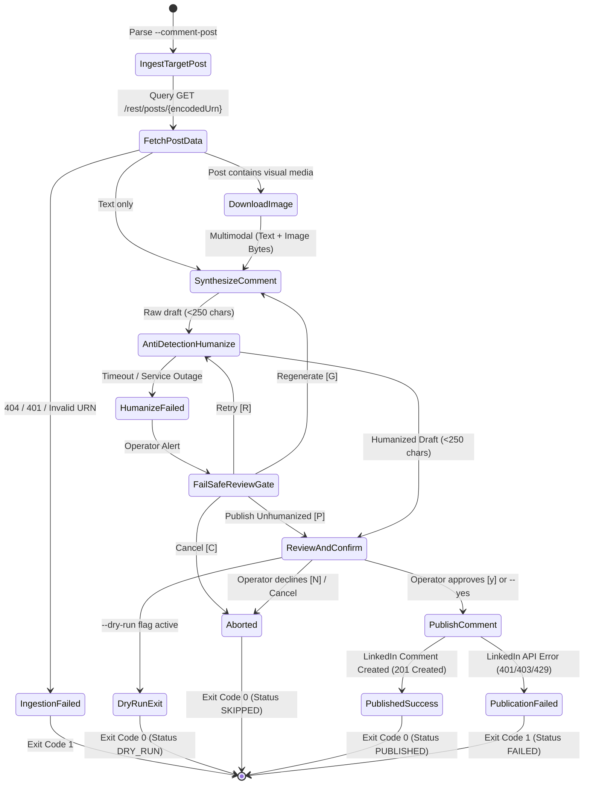

# Data Model & State Transitions: Multimodal LinkedIn Post Commenting Pipeline

**Branch**: `005-generate-post-comment` | **Date**: 2026-10-22 | **Spec**: [spec.md](spec.md)

This document formalizes the domain entities, validation constraints, and lifecycle state transitions for targeted LinkedIn post commenting.

---

## 1. Domain Entities & Schemas

### A. Target Post Representation (`LinkedInPostDetails`)

Represents the extracted LinkedIn post queried from the official REST API.

```python
from typing import Literal
from pydantic import BaseModel, ConfigDict, Field, field_validator

class LinkedInMediaAsset(BaseModel):
    """Media asset attached to a LinkedIn post."""
    model_config = ConfigDict(extra="ignore")

    asset_urn: str | None = Field(default=None, description="e.g. urn:li:digitalmediaAsset:...")
    media_url: str | None = Field(default=None, description="Direct CDN download URL if available")
    mime_type: str = Field(default="image/jpeg")
    title: str | None = None
    media_type: Literal["IMAGE", "DOCUMENT", "VIDEO", "NONE"] = "NONE"


class LinkedInPostDetails(BaseModel):
    """Normalized payload extracted from GET /rest/posts/{encodedUrn}."""
    model_config = ConfigDict(extra="ignore")

    post_urn: str = Field(description="Normalized post URN, e.g. urn:li:activity:... or urn:li:ugcPost:...")
    author_urn: str = Field(description="Author Person or Organization URN")
    author_name: str = Field(default="", description="Resolved display name or handle")
    commentary_text: str = Field(default="", description="Original post body text")
    media: LinkedInMediaAsset = Field(default_factory=LinkedInMediaAsset)
    raw_payload: dict = Field(default_factory=dict, description="Raw API response for debugging")

    @property
    def has_image(self) -> bool:
        return self.media.media_type == "IMAGE" and bool(self.media.media_url or self.media.asset_urn)
```

---

### B. Comment Draft Representation (`TargetCommentDraft`)

Represents the synthesized and humanized comment through its lifecycle.

```python
class TargetCommentDraft(BaseModel):
    """Generated commentary draft and its anti-detection humanization state."""
    model_config = ConfigDict(extra="ignore")

    raw_text: str = Field(
        min_length=10,
        max_length=250,
        description="Initial multimodal completion matching author persona"
    )
    humanized_text: str = Field(
        default="",
        max_length=250,
        description="Rewritten text after passing through HumanizeAI.pro"
    )
    ai_detection_score: float | None = Field(
        default=None,
        ge=0.0,
        le=100.0,
        description="Probability of AI authorship reported by detector"
    )
    humanize_status: Literal["SUCCESS", "FAILED_HUMANIZATION", "BYPASSED", "PENDING"] = "PENDING"

    @property
    def publishable_text(self) -> str:
        """The final approved text to post (humanized if available, raw if bypassed)."""
        return self.humanized_text if self.humanized_text else self.raw_text

    @property
    def character_count(self) -> int:
        return len(self.publishable_text)
```

---

### C. Comment Publication Record (`CommentPublicationRecord`)

The immutable record emitted upon terminal execution of the commenting flow.

```python
from datetime import datetime, UTC

CommentPublicationStatus = Literal["PUBLISHED", "DRY_RUN", "SKIPPED", "FAILED"]

class CommentPublicationRecord(BaseModel):
    """Result of attempting to publish a comment via official LinkedIn API."""
    model_config = ConfigDict(extra="ignore")

    target_post_urn: str
    actor_urn: str
    comment_text: str
    status: CommentPublicationStatus
    comment_urn: str | None = None
    published_at: datetime | None = None
    error_message: str | None = None

    @field_validator("published_at")
    @classmethod
    def _ensure_utc(cls, v: datetime | None) -> datetime | None:
        if v is None:
            return None
        return v.replace(tzinfo=UTC) if v.tzinfo is None else v.astimezone(UTC)
```

---

## 2. State Transition Lifecycle

The targeted post commenting flow operates as a deterministic, fail-safe state machine:



---

## 3. Validation Invariants & Guardrails

1. **Length Constraint**:
   - `publishable_text` MUST be $\le$ 250 characters and $\ge$ 10 characters.
   - Any humanized completion exceeding 250 characters triggers the fail-safe review gate for operator manual trimming.
2. **Stylometric Hygiene**:
   - `0` emojis allowed.
   - `0` hashtags allowed.
   - `0` participial sentence starters (`-ing` words).
   - Maximum 1 paragraph (no internal `\n\n` line breaks).
3. **URN Normalization**:
   - Clean all web query parameters (e.g. `?trackingId=...`).
   - Extract numeric post identifier and normalize to valid LinkedIn URN format.
